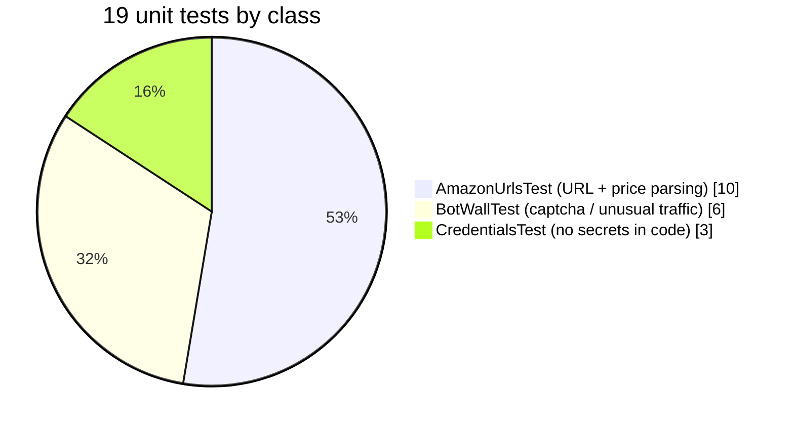
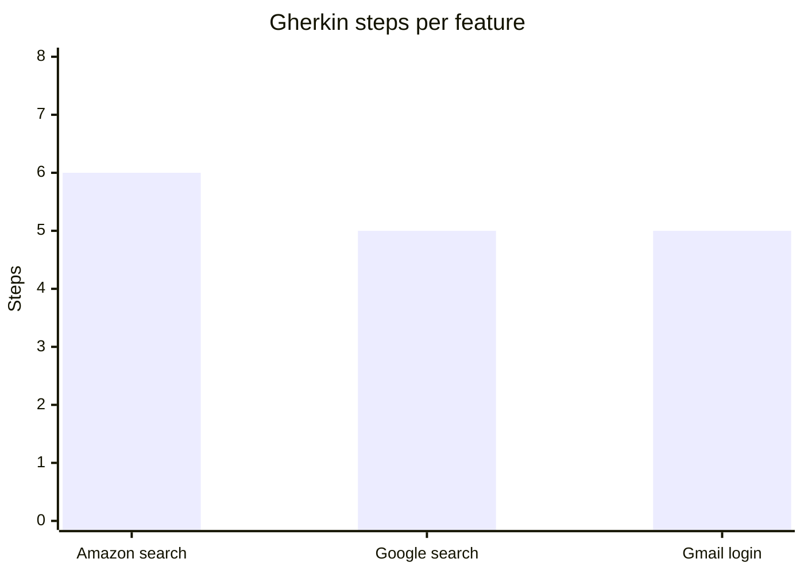
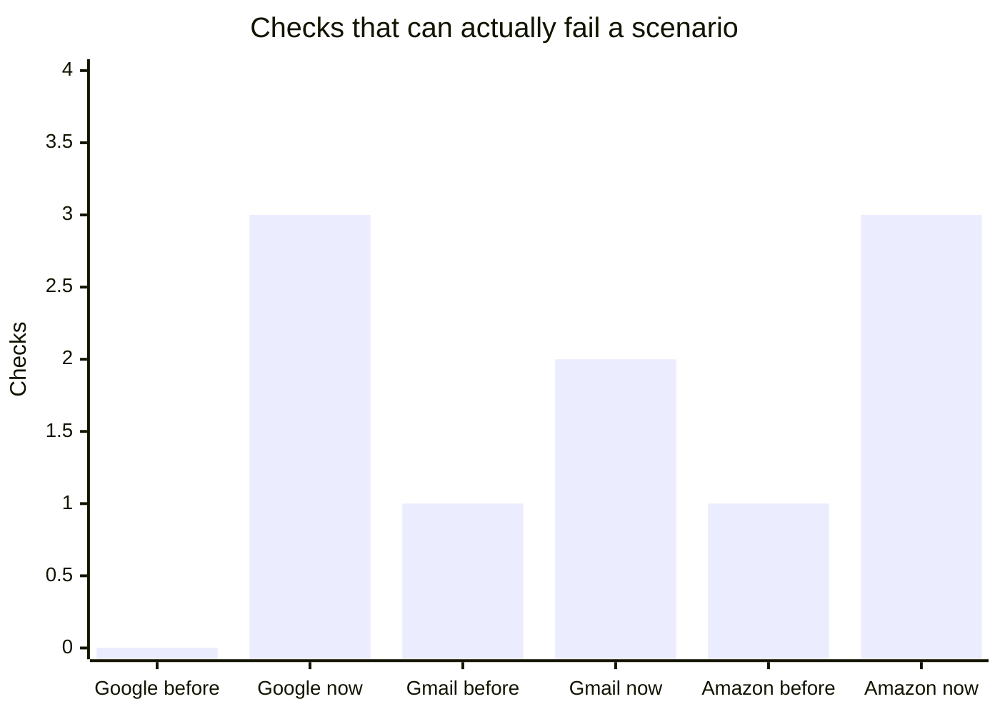
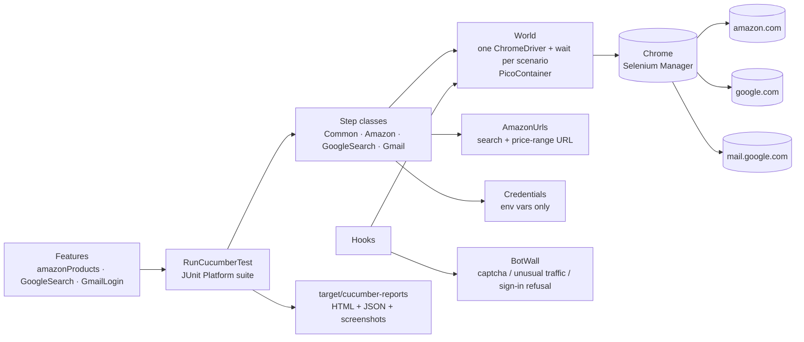
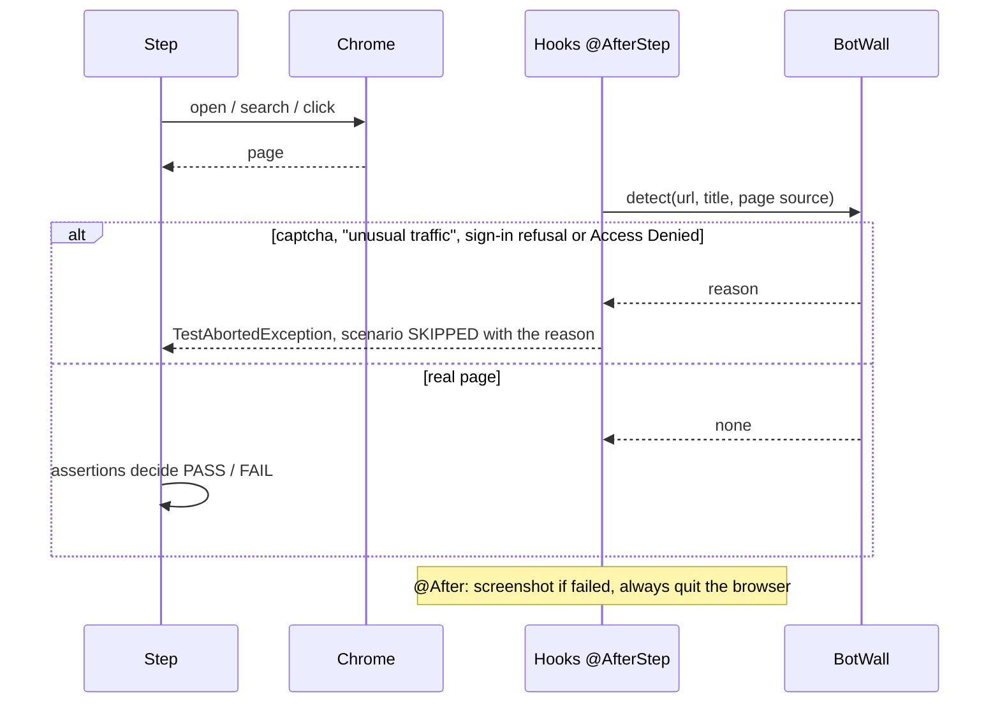
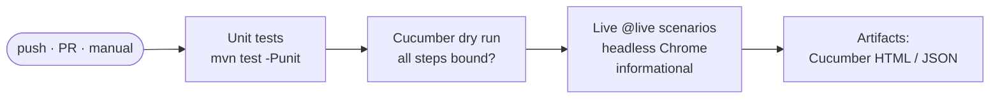
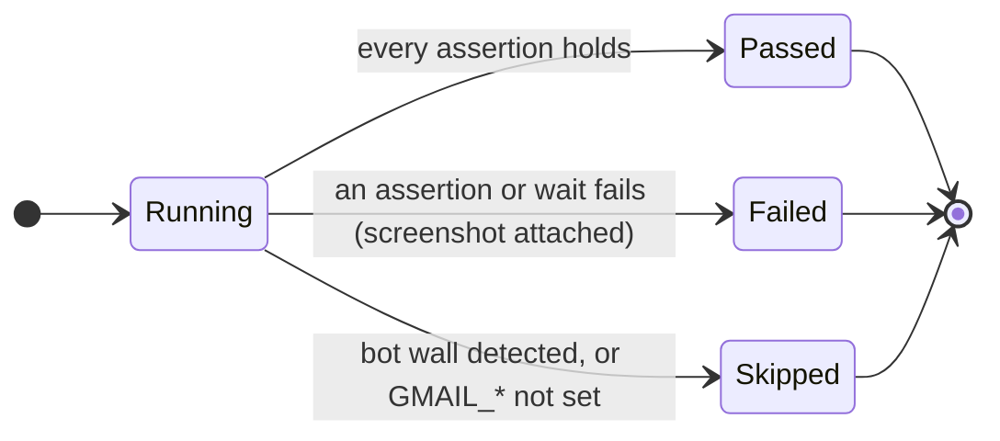

<div align="center">

# 🛒 Amazon · Google · Gmail — Selenium + Cucumber BDD

### Java Selenium 4 + Cucumber 7 scenarios for Amazon product search, Google search and Gmail login, rebuilt so every test can actually fail, with no credentials in the code and CI on every push

[](https://git.io/typing-svg)

<!-- ============ STATUS BAR ============ -->
[](https://github.com/rbchy/AmazonSeleniumTest/actions/workflows/ci.yml)


</div>

---

## 📌 At a Glance

<table>
<tr>
<td width="50%" valign="top">

**🙋 What this is**

A Cucumber BDD project that drives a real Chrome browser against three of the hardest public targets: **Amazon**, **Google** and **Gmail**. Each scenario:

- shares one browser through dependency injection;
- asserts what the page really shows;
- attaches a screenshot when it fails.

The big sites protect themselves from bots. When a run lands on a captcha or "unusual traffic" page, the framework **reports the scenario as SKIPPED and says why**. It does not try to get around the protection.

GitHub Actions runs the unit tests and a Cucumber **dry run** on every push. The dry run proves every Gherkin step has code behind it. The live Amazon / Google scenarios run afterwards for information.

</td>
<td width="50%" valign="top">

**📍 Quick facts**

| | |
|---|---|
| 🥒 **Features** | 3 · 3 scenarios · 16 steps |
| 🧪 **Unit tests** | 19 (URL builder, bot-wall detector, credentials guard) |
| ✅ **CI** | unit 19 / 19 · dry run 3 / 3 · ≈ 1 min |
| 🌐 **Live** | Amazon + Google, skipped with the reason when blocked |
| 🔐 **Secrets** | none in code; Gmail reads `GMAIL_USER` / `GMAIL_PASSWORD` |
| 🧱 **Design** | PicoContainer `World`, hooks, JUnit Platform suite |

</td>
</tr>
</table>

---

## ✅ Latest Results (GitHub Actions)

| Job | What runs | Result |
|---|---|---|
| **Unit tests** | `AmazonUrlsTest` 10 · `BotWallTest` 6 · `CredentialsTest` 3 | ✅ 19 / 19 |
| **Cucumber dry run** | every step of all 3 features is bound to code (`@manual` included) | ✅ 3 / 3 |
| **Live: Google search** | headless Chrome on a GitHub runner | ⏭️ skipped: *Google 'unusual traffic' check (/sorry/)* |
| **Live: Amazon search** | headless Chrome on a GitHub runner | ⏭️ skipped: *Amazon automated-access block page* |
| **Gmail login** | `@manual`: needs a real account and a normal network | — not run in CI |

> From a home or office network the live scenarios run end to end. In a datacenter they are stopped by the sites' bot protection, and the report says exactly that instead of failing with a misleading "element not found".





### Before → after this update



| | Before | Now |
|---|---|---|
| `mvn test` runs scenarios | ❌ no runner, nothing ran | ✅ JUnit Platform suite |
| Real passwords in the code | ❌ 2 Gmail logins | ✅ none, plus a test that fails the build if one is added |
| Google search can fail | ❌ every error was caught and printed | ✅ title + results asserted |
| Browsers left open | ❌ Gmail opened two, closed one | ✅ one per scenario, always closed |
| Bot-detection evasion flags | ❌ UA spoofing, `AutomationControlled` off | ✅ removed; walls are detected and reported |
| CI | ❌ none | ✅ unit + dry run gate, live informational |

---

## 🏗️ Architecture



### 🚧 How a bot wall is handled



### 🔁 CI pipeline



---

## 🥒 Scenarios



| Feature | Tags | Steps | What is asserted |
|---|---|---|---|
| 🛒 **Amazon product search** | `@amazon @live` | Home page → search *"Google Pixel 9"* → price $400–$2,500 → filters *Unlocked*, *Google* (if offered) | The results header echoes the query, there is at least one result, and the price range is in the URL. The filters that were applied are logged. |
| 🔎 **Google search** | `@google @live` | Google → type *"Cucumber Java"* → Enter | The title contains the query, and at least one organic result |
| ✉️ **Gmail login** | `@gmail @manual` | Gmail → email → password | The Inbox URL, and the Compose button is visible |

---

## ▶️ Running the Tests

**You need:** JDK 17+, Maven 3.8+ and Google Chrome. Selenium Manager downloads the matching driver.

```bash
# fast unit tests (no browser)
mvn test -Punit

# all scenarios except @manual, in a visible Chrome window
mvn test -Dtest=RunCucumberTest

# only Amazon, headless
mvn test -Dtest=RunCucumberTest -Dheadless=true "-Dcucumber.filter.tags=@amazon"

# Gmail (your own account, from a normal network; never commit these)
export GMAIL_USER='you@example.com' GMAIL_PASSWORD='...'
mvn test -Dtest=RunCucumberTest "-Dcucumber.filter.tags=@gmail"

# check that every step is implemented, without opening a browser
mvn test -Dtest=RunCucumberTest -Dcucumber.execution.dry-run=true -Dcucumber.filter.tags=
```

The report is written to `target/cucumber-reports/report.html`, with a screenshot attached to every failed scenario.

> Gmail: Google often refuses sign-in from automated browsers ("This browser or app may not be secure"). The scenario then **skips with that reason**. Accounts with 2-Step Verification cannot be automated this way.

---

## 📁 Project Structure

```text
AmazonSeleniumTest/
├── .github/workflows/ci.yml
├── src/test/java/com/rbchy/amazon/
│   ├── RunCucumberTest.java          # JUnit Platform suite (glue, plugins)
│   ├── steps/                        # CommonSteps · AmazonSteps · GoogleSearchSteps · GmailSteps · Hooks
│   ├── support/                      # World · AmazonUrls · BotWall · Credentials
│   └── unit/                         # AmazonUrlsTest · BotWallTest · CredentialsTest
├── src/test/resources/Features/      # amazonProducts · GoogleSearch · GmailLogin
└── pom.xml                           # Selenium 4.27 · Cucumber 7.20 · JUnit 5 · `unit` profile
```

---

## 🧹 Maintenance Log

The README was checked against the code, and these issues were fixed:

| Issue found | Fix |
|---|---|
| 🔑 **Real Gmail credentials in the source.** `GmailSteps.java` held two accounts (one commented out) with their passwords. | Removed. The values come from `GMAIL_USER` / `GMAIL_PASSWORD`, and `CredentialsTest` fails the build if a Gmail address or hard-coded password appears in `src/` again. **The old passwords are still in the Git history: change them.** |
| ▶️ **`mvn test` ran nothing:** there was no Cucumber runner | Added a JUnit Platform suite and the `cucumber-junit-platform-engine` |
| 🙈 **Steps that could not fail.** Google search caught every exception and printed "FAILED". "Compose button should be visible" only closed the browser. The Amazon "logged in" step never logged in. | Real assertions everywhere. The Amazon step is renamed to what it does ("on the Amazon home page"). |
| 🪟 **Leaked browsers.** Each step class had its own `driver`, so the Gmail scenario opened a Chrome in `GoogleSearch` that was never used or closed. | One browser per scenario through a PicoContainer `World`, always quit in `@After` |
| 🔗 **The price filter broke URLs.** It appended `&low-price=…` blindly (no `?`, fragments lost), and it refused to change an existing range. | Added `AmazonUrls.withPriceRange`, with 10 unit tests |
| 🛡️ **Bot-detection evasion.** The tests spoofed the user agent and hid the automation flags. | Removed. Captcha / "unusual traffic" / sign-in refusal pages are detected and the scenario is reported as skipped with the reason. |
| 🧾 **Silent filters.** Nine filters were tried, and any that was missing was ignored with a vague message. | The filter list lives in the feature file, and the applied / not-offered filters are logged |
| 📝 **The README promised things that weren't there:** sign-up and login to Amazon, and "add the product into cart" | Rewritten to match the scenarios that exist (cart and sign-up are on the roadmap) |
| 📦 `target/` and Eclipse files were committed | Removed, and added a `.gitignore` |

---

## 📈 Roadmap

- [ ] Amazon: open the first result, check the product title and price, then add to cart (as a guest)
- [ ] Assert that every listed price falls inside the chosen range (`AmazonUrls.parsePrice` is ready)
- [ ] Page Objects for the Amazon search results and product page
- [ ] Run the live scenarios on a self-hosted runner from a residential network
- [ ] Allure report next to the Cucumber HTML

---

## 🔗 Related Projects

| Project | Stack |
|---|---|
| 🏔️ [NorthFace × Automation Exercise BDD](https://github.com/rbchy/NorthFace_AutomationExercise-BDD-Test-Automation) | Selenium · Cucumber · RestAssured · bot-wall aware CI |
| 📱 [WDIO Native Demo App – Appium](https://github.com/rbchy/WebdriverIO-Native-DemoApp-MobileTestAutomationJavaAppiumTestNG) | Appium 2 · TestNG · Android emulator in CI |
| 🏦 [ParaBank Banking Automation](https://github.com/rbchy/ParaBank-BankingAutomationJavaSelenium) | Java · Selenium · CI |
| ⭐ [RbcTcsWorld E-Commerce Suite](https://github.com/rbchy/RbcTcsWorld_ECommerceSuite) | Spring Boot · REST Assured · Selenium · Playwright · CI quality gates |

<sub>All projects: [github.com/rbchy](https://github.com/rbchy)</sub>

---

## ⚠️ Disclaimer

This is a portfolio / training project. It sends a handful of ordinary page requests, and it **stops** when a site signals that it does not want automated traffic. Respect each site's terms of use, and never automate an account you do not own.

---

## 👤 Author

<div align="center">

**Ranajit Baran Chowdhury (RB Chowdhury)**
QA Automation Engineer / SDET · West Norriton, Pennsylvania, USA

[](https://www.linkedin.com/in/rbchy/)
[](https://github.com/rbchy)
[](https://rbchy.github.io/rbchy/)
[](https://rbc6543.wixsite.com/rbc-portfolio)
[](mailto:chyranajit@gmail.com)

<sub>MIT licensed — see [LICENSE](LICENSE).</sub>

⭐ *If this project helps you, a star on the repo is appreciated.*

</div>
